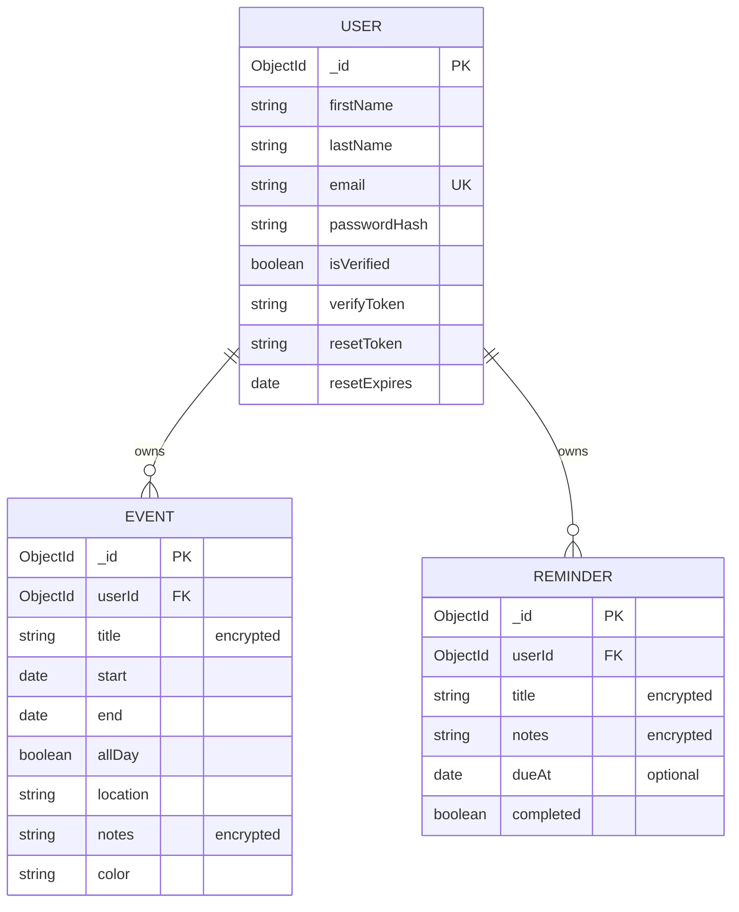

# Team 6 Calendar + Reminders (COP4331C MERN Project)

Built from the course MERN tutorial. Runs in local Docker.

```bash
cd cards-backend
cp .env.example .env    # set JWT_SECRET and DB_ENCRYPTION_KEY
docker compose up --build -V
docker compose exec api npm run seed    # create or reset the demo account
```

API: http://localhost:5000/api/ping · MongoDB: `mongodb://localhost:27017` (database `CalendarDB`) · Demo login: `demo@example.com` / `Demo123!`

## Database

Event and reminder `title` and `notes` are encrypted (AES-256-GCM) before they reach the database.


